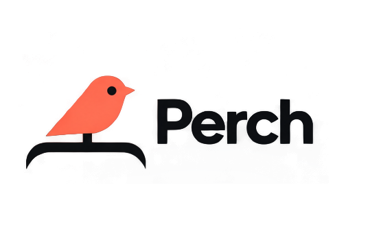

<div align="center">

<picture><source media="(prefers-color-scheme: dark)" srcset="docs/media/logo-light.png"></picture>

# Perch

**A tiny friend that lives in your Mac's notch — or at the top of your screen on Windows — and keeps an eye on your coding-agent sessions.**

Approve permissions, watch your agents work, drop a file, chat with Claude — all without leaving what you're doing.


</div>

---

## Why

Some studios showed off gorgeous notch companions… and never let anyone use them.
**Perch is the open version** — every line of code, every animation, every sound —
free to use, read, fork and remix. Every line of code, every animation, every sound —
free to use, read, fork and remix.

Meet **Pip**: a soft little squircle with big eyes that pops out of your notch, waves hello, follows your cursor with its eyes, gets annoyed when you poke it (and dizzy if you insist), and tells you the moment your agents need you.

## Features

- 🤖 **Every coding agent, live** — Claude Code, Codex, OpenCode, Zcode and anything else (via a tiny wrapper) each get their own pill: what they read, edit and run, step by step. Finished? Pip does a happy little jump. See [`agents/`](agents/) for setup.
- ✅ **Approve from the notch** — Claude Code permission requests show up with **Allow / Deny**. One click, back to work.
- 🧑‍💻 **Jump to the right terminal** — open the exact terminal window of a session *(macOS)*.
- 💬 **Ask Claude anything** — built-in chat, straight from the notch.
- 📎 **Drop a file on the notch** — Pip turns into a box and swallows it, then ask a question about it or send it by email *(email: macOS, Mail.app)*.
- 🪟 **Drag Pip onto any window** — attach that window as context for Claude *(macOS)*.
- 🔌 **Integrations** — Stripe payments, n8n workflows, GitHub, Vercel deployments, Resend emails, Notion, Cal.com. Each one gets its own little colored Pip.
- 🎭 **A real character** — idle breathing, blinks, eyes on a sphere that follow your mouse, emotes, 28 handcrafted sounds, a greeting on launch.
- 🫥 **Invisible when idle** — hides away when nothing is running, peeks out when you hover the notch (the top edge of the screen on Windows).
- 🖥️ **Any Mac, notch or not** — on an iMac, a Mac mini, or a MacBook with its lid closed on an external display, Pip sits in a small bar at the top of the screen.
- 🔒 **Private by design** — no telemetry, no account. Keys live in your macOS Keychain or Windows Credential Manager. The app only talks to the services you plug in.

## Install

### Download for macOS

1. Grab the latest `Perch.zip` from [Releases](https://github.com/rishto07/perch/releases).
2. Unzip and move **Perch.app** to `/Applications`.
3. Launch. This build isn't notarized by Apple yet, so the first time macOS says it can't verify the developer: open **System Settings → Privacy & Security**, scroll down and click **Open Anyway** (only once).

### Windows

The Windows installer is **temporarily unavailable**. Microsoft Defender wrongly
flags the unsigned installer as malware; a false-positive report is under review
at Microsoft and the installer will come back once it is cleared and signed.
Until then you can [build it from source](#build-from-source).

There is no notch on a PC, so the island slides out of the top edge of the screen
instead of hiding inside one. See [`windows/README.md`](windows/README.md) for the
rest of the differences.

### Build from source

**macOS** — requirements: macOS 15+, Xcode 16+, [XcodeGen](https://github.com/yonaskolb/XcodeGen).

```bash
brew install xcodegen
git clone https://github.com/rishto07/perch.git
cd perch/Perch
xcodegen
open Perch.xcodeproj   # then ⌘R
```

**Windows** — requirements: [Rust](https://rustup.rs), Node 20+, MSVC build tools.

```powershell
git clone https://github.com/rishto07/perch.git
cd perch/windows
npm install
npm run pack                # installer lands in windows/release/
```

## Setup

Click the Perch icon in the menu bar (macOS) or in the system tray (Windows) → **Settings…**

| What | Why | Where the key goes |
|---|---|---|
| **Claude Code hooks** | live sessions and approvals | **Install hooks** — Perch backs up `~/.claude/settings.json`, merges its hooks and shows you the diff before writing anything |
| **Other agents** | Codex, OpenCode, Zcode, … | Settings → Other coding agents → Install (or Connect all); scripts in [`agents/`](agents/) |
| **Chat provider key** | chat and questions about files — Claude, OpenAI, Gemini, Mistral, Groq, OpenRouter or a local Ollama | Keychain / Windows Credential Manager |
| Stripe, n8n, GitHub, Vercel, Resend, Notion, Cal.com | the integration pills | Keychain / Windows Credential Manager, all optional |

If Perch isn't running, the hook exits immediately: **your agent is never blocked.**

## Things to try

| Do this | Pip does that |
|---|---|
| Hover the notch (top edge on Windows) | peeks out and says hi 👋 |
| Click it | opens |
| Hover Pip | blinks, eyes grow |
| Click Pip | squish + annoyed |
| Click 3 times fast | 😵‍💫 dizzy for a few seconds |
| Drag a file onto the island | turns into a box and swallows it |
| Drag Pip onto a window *(macOS)* | attaches it as context |

## How it works

**macOS**

- **Island**: a borderless `NSPanel` hugging the notch, driven by a small state machine (`hidden → petit → home`).
- **Character**: drawn in SwiftUI `Canvas` + `TimelineView` at 60 fps — squircle body, eyes projected on a sphere, spring animations. No Rive, no Lottie, no images.
- **Agents**: a tiny `perch-hook` script receives hook events and forwards them over a Unix socket to the app (Claude Code installs from Settings; Codex/OpenCode/others via [`agents/`](agents/)). For Claude approvals it waits for your click, then answers the hook. Every event carries an `agent` tag that routes to its own pill.
- **Integrations**: lightweight pollers, paused when nothing is watching.
- **Sounds**: 28 short WAVs played through preloaded `AVAudioPlayer`s.

The macOS app is native Swift 6 / SwiftUI / AppKit with **zero third-party dependencies**.

**Windows**

- A [Tauri 2](https://tauri.app) app (Rust + TypeScript): the island is a transparent, always-on-top window that never steals focus, Pip is drawn in Canvas 2D with the same shapes, timings and sounds as on the Mac.
- Agent hooks go through a tiny `perch-hook.exe` and a named pipe; keys live in Windows Credential Manager.
- Details and differences in [`windows/README.md`](windows/README.md).

## Contributing

Issues and PRs are very welcome — new integrations, new emotes, new sounds, bug fixes. See [CONTRIBUTING.md](CONTRIBUTING.md).

## Credits

Perch is an independent project — not affiliated with any design studios or their
notch-companion concepts. Rebranded to Perch with Pip, extended to every coding agent.

## License

- **Code:** [Apache-2.0](LICENSE) — use it, fork it, learn from it, just keep the copyright and NOTICE attributions.
- **Brand and artwork:** Perch ships its own name (Perch), character (Pip, drawn in code), icons (generated by `windows/scripts/gen-icons.mjs`) and sounds (synthesized by `windows/scripts/gen-sounds.mjs`). Some documentation media may still show earlier designs — replace them with fresh captures after a running build.

<div align="center">

**If Pip made you smile, a ⭐ helps a lot.**

[Repository](https://github.com/rishto07/perch)

</div>
